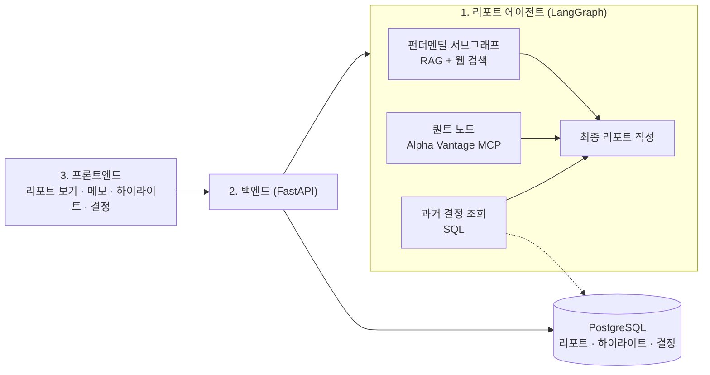
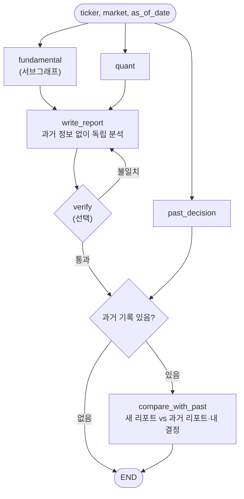
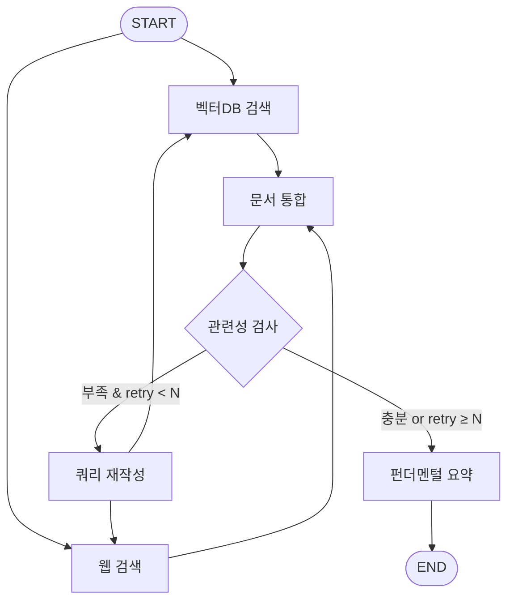
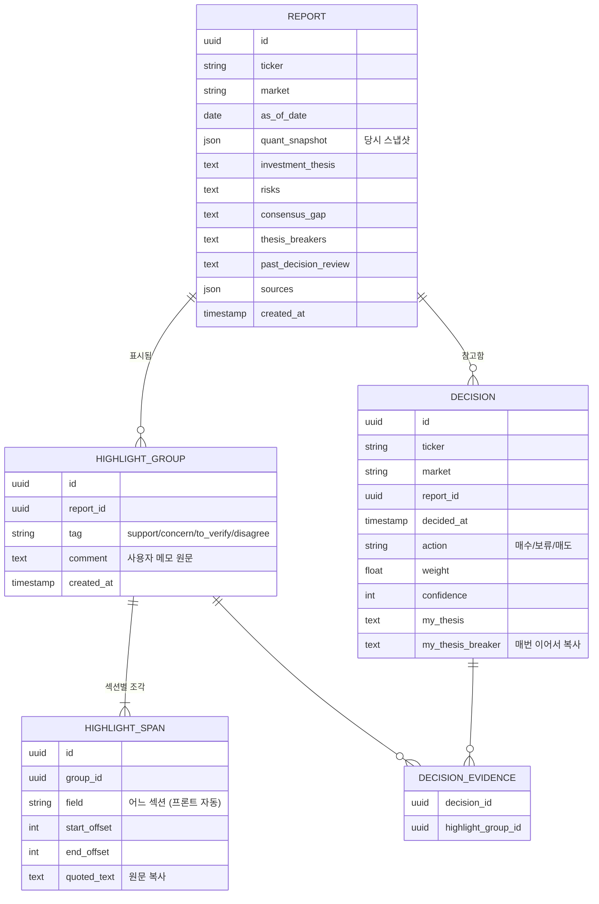

# 투자 의사결정 기록 시스템 설계

> 작성일: 2026-10-20 · 마감: 2026-10-22(목) 13:00
> 1차 구현 범위: 미국 주식(US). 국내 주식(KR)은 같은 구조에 어댑터를 추가하는 방식으로 확장

---

## 1. 문제의식과 목표

- 시장이 기대치에 크게 좌우되어, 실적이 좋아도 컨센서스에 못 미치면 급락함 → 펀더멘털만으로 판단하기 위험
- 기술 변화가 빠른 시기라 퀀트만 돌리면 저평가된 좋은 종목을 놓칠 수 있음
- **해결 방향**: 펀더멘털 관점과 퀀트 관점을 도구가 정리하고, **최종 결정은 사용자가 내리며**, 그 결정과 근거를 기록해 이후 리밸런싱과 의사결정 때 되돌아볼 수 있게 함

핵심 가치는 자동매매가 아니라 **내 판단을 검증 가능하게 만드는 것**이다. 주문 기능은 범위에 넣지 않는다.

---

## 2. 전체 구성

---

## 3. 에이전트 설계

### 3.1 설계 원칙: 에이전트가 아니라 워크플로우

- 흐름은 개발자가 엣지로 고정한다. Supervisor처럼 LLM이 다음 단계를 고르는 방식은 쓰지 않는다
- **이유: 리포트 간 비교 가능성.** 같은 종목을 분석할 때마다 구성이 달라지면 복기 시스템이 성립하지 않음
- LLM의 판단이 들어가는 곳은 펀더멘털 서브그래프의 쿼리 재작성, 퀀트 수치 해석, 리포트 작성, 과거 결정 비교로 한정
- **에이전트의 확증 편향 방지**: 현재 시점 분석은 과거 판단을 보지 않고 독립적으로 작성하고, 과거와의 비교는 그 뒤에 별도 단계로 수행
- 발표 시 표현: "역할별 서브그래프를 병렬 실행하는 워크플로우이며, Supervisor 대신 고정 흐름을 택한 이유는 리포트 간 비교 가능성"

### 3.2 메인 그래프

- `fundamental`, `quant`, `past_decision` 세 갈래는 병렬(fan-out)로 실행
- `write_report`는 **`fundamental`과 `quant` 결과만** 받는다. `past_decision` 결과는 `compare_with_past`에서만 사용
- `verify`는 시간이 남을 때 추가. 리포트의 숫자를 `quant_snapshot` 및 출처와 대조해 환각을 막는 역할
- 과거 기록이 없으면 `compare_with_past`를 건너뛰고 종료 (조건부 엣지)

### 3.3 펀더멘털 서브그래프 (기존 `agent/structure.ipynb` 활용)

- 재검색 루프를 서브그래프 안에 가둬서, 루프가 돌아도 메인 그래프의 퀀트·과거 결정 조회가 다시 실행되지 않게 함
- 서브그래프 State는 메인 State와 **분리**하고, 변환 함수로 감싸 메인 그래프에 노드로 추가
- `retry_count`로 재시도 횟수 제한 (2~3회)
- 구현 순서: **웹 검색만으로 먼저 동작** → 이후 벡터DB 검색 추가

### 3.4 퀀트 노드

- LLM이 툴을 고르지 않고, **항상 같은 호출을 같은 순서로** 실행
- 시장별 어댑터가 데이터를 가져와 **공통 `QuantSnapshot` 스키마**로 변환. 그래프에는 KR/US 분기를 만들지 않음
- LLM은 숫자를 해석해 `quant_summary`를 작성하는 데만 사용

| 목적 | Alpha Vantage 함수 | 얻는 것 |
|---|---|---|
| 기업 개요·밸류에이션 | `OVERVIEW` | PER, Forward PE, PBR, ROE, 이익률, 애널리스트 목표주가 |
| 현재가 | `GLOBAL_QUOTE` | 가격, 등락률 |
| 모멘텀 | `TIME_SERIES_DAILY` | 시계열 → 6·12개월 수익률은 코드로 계산 |
| 실적 서프라이즈 | `EARNINGS` | 분기별 예상 EPS 대비 실제 EPS |

- `OVERVIEW`의 목표주가·Forward PE와 `EARNINGS`의 서프라이즈가 리포트의 **"컨센서스 대비 차이점"** 근거
- 무료 플랜 호출 제한 대응: 종목·날짜별 결과 캐싱
- 퀀트 점수나 순위는 **같은 시장 안에서만** 비교 (회계 기준·시장 평균 밸류에이션이 다름)

### 3.5 과거 결정 조회 노드

- RAG 없이 **SQL**로 처리: 해당 `ticker`의 최신 결정 1건과 그에 연결된 리포트·하이라이트
- 철회 조건이 최신 결정에서 빠지는 문제는 **결정 저장 시 철회 조건을 매번 이어서 복사**하는 방식으로 해결 → 최신 1건만 조회해도 충분
- 처음 분석하는 종목이면 빈 값으로 통과
- 조회 결과는 `write_report`에 넣지 않고 `compare_with_past`에만 전달

### 3.6 리포트 작성 노드 (`write_report`)

- `fundamental_summary`, `quant_snapshot`, `quant_summary`만으로 고정 스키마(`Report`)를 구조화 출력
- `past_decision_review`를 제외한 모든 필드를 작성
- **과거 판단을 보지 않는다.** 과거 판단을 컨텍스트에 넣으면 LLM이 그 판단을 확인하는 방향으로 쓰는 경향이 있어, 새 분석이 과거 분석의 반복이 됨

### 3.7 과거 결정 비교 노드 (`compare_with_past`)

이 노드가 일반 리포트 생성기와 구분되는 **핵심 차별점**이다. 완성된 새 리포트와 과거 기록을 비교해 `past_decision_review` 필드만 채운다.

| 비교 대상 | 내용 | 예시 |
|---|---|---|
| 데이터 변화 | 과거 `quant_snapshot` vs 현재 | "PER 35 → 28, 직전 분기 EPS 서프라이즈 +8%" |
| 철회 조건 점검 | 내가 정한 `my_thesis_breaker`가 새 데이터에서 충족됐는지 | "철회 조건 '데이터센터 매출 성장률 20% 미만'에 해당하지 않음" |
| 확인 필요 항목 | 🟡 하이라이트가 새 데이터에서 어떻게 나왔는지 | "'마진 압박' 우려가 이번 분기에 현실화됨" |
| 매수 근거 유효성 | 🟢 하이라이트·`my_thesis`가 여전히 유효한지 | "근거로 삼은 신규 고객사 확보는 진행 중" |

- 각 항목은 **"해당함 / 해당하지 않음 / 판단 근거 부족"** 으로 보고하고 근거 출처를 남긴다
- 매수·매도를 권하지 않는다. 최종 판단은 사용자 몫

---

## 4. 데이터 계약

### 4.1 메인 State

| 키 | 설명 |
|---|---|
| `ticker` | 종목 코드 (US: `AAPL`, KR: `005930`) |
| `market` | `"US"` / `"KR"` — 티커로 추측하지 않고 명시적으로 받음 |
| `as_of_date` | 분석 기준일 |
| `fundamental_summary` | 펀더멘털 서브그래프 결과 |
| `quant_snapshot` | `QuantSnapshot` |
| `quant_summary` | 퀀트 수치 해석 |
| `past_decision` | 과거 결정 조회 결과 (없으면 null) |
| `report` | 최종 `Report` |

### 4.2 펀더멘털 서브그래프 State (메인과 분리)

`ticker`, `market`, `question`, `vector_docs`, `web_docs`, `context`, `relevance`, `retry_count`, `summary`

### 4.3 QuantSnapshot (시장 공통)

`ticker`, `market`, `as_of_date`, `currency`, `price`, `change_pct`, `per`, `forward_per`, `pbr`, `roe`, `profit_margin`, `return_6m`, `return_12m`, `analyst_target_price`, `last_eps_estimate`, `last_eps_actual`, `eps_surprise_pct`

### 4.4 Report (에이전트 출력, 고정 스키마)

| 필드 | 내용 | 주요 근거 |
|---|---|---|
| `investment_thesis` | 투자 논리 | 10-K Item 1, Item 7 |
| `risks` | 리스크 | 10-K Item 1A |
| `consensus_gap` | **컨센서스 대비 차이점** (시장 기대치와 현재 데이터가 갈리는 지점) | 퀀트 노드, 웹 검색 |
| `thesis_breakers` | 이 논리가 틀렸다고 볼 조건 | 위 전체 |
| `past_decision_review` | 과거 결정 대비 변화, 철회 조건·확인 필요 항목 점검 (과거 기록이 있을 때) | `compare_with_past`가 별도로 작성 |
| `sources` | 출처 목록 | 전체 |

> "내 시각"은 에이전트가 채우지 않는다. 사용자가 프론트에서 메모·하이라이트로 남긴다.

---

## 5. 데이터 소스와 RAG

### 5.1 시장별 소스

| | 미장 (US, 1차) | 국장 (KR, 2차) |
|---|---|---|
| 퀀트/시세 | Alpha Vantage MCP | KIS MCP (모의투자 앱키) |
| 사업보고서 | SEC EDGAR (10-K, 10-Q) | DART OpenAPI |
| 증권사 리포트 | 시연 종목만 수동 수집 | 시연 종목만 수동 수집 |
| 컨센서스 | Alpha Vantage `OVERVIEW`, `EARNINGS` | 무료 구조화 데이터 부족 → 웹 검색으로 보완, 출처 필수 |

- SEC EDGAR: API 키는 없지만 **연락처가 들어간 User-Agent 헤더 필수**, 초당 요청 수 제한 준수
- LangGraph에서 MCP 툴 연결: `langchain-mcp-adapters`

### 5.2 RAG 범위

- 10-K는 통째로 넣지 않고 **Item 1(Business), Item 1A(Risk Factors), Item 7(MD&A)** 만 적재
- 적재 대상은 **시연 종목 2~3개**로 한정
- 메타데이터: `market`, `ticker`, `doc_type`, `section`, `published_at` → 검색 시 필터링
- 미국 문서(영어)와 국내 문서(한국어)가 섞이므로 **다국어 임베딩 모델** 사용

---

## 6. DB 설계

### 6.1 원칙

1. **리포트는 저장 후 수정하지 않는다 (immutable).** 하이라이트 위치가 어긋나지 않게 하고, 결정 시점에 알던 정보를 박제하기 위함. 과거 결정을 복기할 때 에이전트를 다시 돌리면 이후 정보가 섞이는 미래 정보 누수(look-ahead bias)가 생김
2. **하이라이트는 위치(offset)와 원문을 함께 저장한다.** 사용자는 섹션 경계와 상관없이 자유롭게 드래그하고, 여러 섹션에 걸친 선택은 프론트가 섹션별 조각(span)으로 나눠 같은 그룹으로 묶는다. offset은 섹션 텍스트 기준
3. **사용자가 쓴 원문은 그대로 보존한다.** LLM으로 요약하거나 태그를 추천하더라도 별도 필드에 저장
4. **하이라이트와 결정은 별도로 기록한다.** 결정은 명시적 버튼으로 남기고, 근거가 된 하이라이트를 연결

### 6.2 ERD

### 6.3 하이라이트 태그

| 태그 | 의미 | 활용 |
|---|---|---|
| 🟢 근거 | 매수 근거로 채택 | 결정 근거로 연결 |
| 🔴 우려 | 리스크로 인정 | 리밸런싱 때 재확인 |
| 🟡 확인 필요 | 다음 실적 등에서 검증할 것 | 사실상 철회 조건 후보. 과거 결정 조회 시 우선 노출 |
| ⚪ 반대 | 에이전트 분석에 동의하지 않음 | 에이전트 대비 내 판단의 성과 비교 |

---

## 7. 백엔드 API (초안)

| 메서드 | 경로 | 역할 |
|---|---|---|
| `POST` | `/analyze` | `{ticker, market}` → 에이전트 실행, 리포트 저장 후 반환 |
| `GET` | `/reports/{report_id}` | 리포트 조회 |
| `GET` | `/reports?ticker=` | 종목별 리포트 이력 |
| `POST` | `/reports/{report_id}/highlights` | 하이라이트 그룹 저장 (태그·메모 + 조각 목록) |
| `GET` | `/reports/{report_id}/highlights` | 하이라이트 그룹 조회 |
| `POST` | `/decisions` | 결정 저장 (근거 하이라이트 그룹 ID 포함) |
| `GET` | `/decisions/{ticker}` | 종목별 과거 결정 조회 |

- 그래프는 FastAPI lifespan에서 1회 컴파일해 `app.state`에 보관 (기존 `fastapi/app.py`의 싱글턴 패턴 활용)
- 에이전트 실행이 수십 초 걸릴 수 있음. 1차는 **동기 호출 + 프론트 로딩 표시**, 여유가 있으면 SSE 스트리밍

---

## 8. 프론트엔드 기능

1. 종목 입력 → 분석 요청 → 로딩 → 리포트 섹션별 표시
2. 텍스트 하이라이트 + 태그 + 메모
   - 리포트 전체에서 섹션 경계와 상관없이 자유롭게 드래그
   - 각 섹션은 `data-field` 속성을 가진 블록으로 렌더링하고, 선택 범위가 걸친 블록마다 조각(span)의 offset을 계산
   - 조각들을 하나의 그룹으로 저장하고 태그·메모는 그룹에 1번만
3. 결정 입력: 매수/보류/매도, 비중, 확신도, 내 철회 조건, 근거 하이라이트 선택
4. 종목별 과거 결정 타임라인

---

## 9. 작업 순서

원칙: **순서대로 하나씩 완성하지 않고, 가짜 데이터로 먼저 끝까지 관통시킨 뒤 채운다.**

| 단계 | 시점 | 내용 |
|---|---|---|
| 0. 계약 정의 | 화 오전 | State, QuantSnapshot, Report 스키마, DB 테이블, API 명세 확정 |
| 1. 관통 | 화 | 노드는 고정값 반환 껍데기 → FastAPI → 프론트 표시 → 결정 저장까지 동작 |
| 2. 노드 교체 | 수 | ① 과거 결정 조회(SQL) + 과거 결정 비교 → ② 퀀트 노드 → ③ 펀더멘털(웹 검색만) → ④ RAG 추가 |
| 3. 프론트 고도화 | 수 밤 | 하이라이트(섹션 걸친 드래그 포함)·태그·메모 |
| 4. 마무리 | 목 오전 (13시 전) | 시연 종목 E2E 테스트, 시연용 과거 결정 1~2건 미리 입력, README·발표 자료. 최소 2~3시간 확보 |

**오늘 바로**: Alpha Vantage API 키 발급, EDGAR User-Agent 준비, 시연 종목 2개 선정(기대치가 높게 반영된 성장주 1 + 저밸류 종목 1), 국장용 KIS·DART 키는 미리 신청

---

## 10. 기존 코드 수정 사항

**`agent/structure.ipynb`**
- `route`가 정의되지 않은 변수(`relevance`, `not relevance`)를 반환 → NameError. `"relevance"`, `"not_relevance"` 문자열 반환으로 수정
- `question`, `message`에 `add_messages` 리듀서 사용 → 메시지 리스트용이므로 문자열 필드에서 제거
- 재검색 루프에 횟수 제한 없음 → `retry_count` 추가
- `add_node(func, func)` → `add_node("이름", func)` 형태로 이름을 문자열로 명시
- State에 `ticker`, `market` 추가, `context` 타입과 실제 값(문서 리스트) 일치시키기

**`fastapi/app.py`**
- `stub_agent` 모듈이 폴더에 없음
- `StubAgent()` 자리에 컴파일된 메인 그래프 연결

---

## 11. 미결정 사항

- [ ] 시연 종목 (US 2개, KR 1~2개)
- [ ] 벡터DB 선택 (PostgreSQL을 쓰므로 pgvector로 통일할지)
- [ ] 다국어 임베딩 모델
- [ ] 리포트 작성용 LLM
- [ ] 검증 노드 포함 여부
- [ ] 동기 호출 vs SSE 스트리밍
